# BreathBreak Project — Complete Image & Figure Catalog

This folder contains **all 20 figures and visualizations** across the BreathBreak project:
- **Images `01`–`15`**: Every embedded figure extracted directly from [../dataset_exploration.ipynb](file:///c:/Users/trahu/OneDrive/Desktop/CodeWorld/HackEdge/dataset_exploration.ipynb) (covering Track 1 manual verification, preprocessing steps `P1`–`P8`, R-peak and PPG detection, feature distributions, Leave-One-Recording-Out evaluation, and 5-fold cross-validation across 5 models).
- **Images `16`–`20`**: All visualizations from the 5 pages of the web application ([../app.py](file:///c:/Users/trahu/OneDrive/Desktop/CodeWorld/HackEdge/app.py)), preprocessing pipeline ([../fatigue_pipeline.py](file:///c:/Users/trahu/OneDrive/Desktop/CodeWorld/HackEdge/fatigue_pipeline.py)), HR alert system ([../hr_report.py](file:///c:/Users/trahu/OneDrive/Desktop/CodeWorld/HackEdge/hr_report.py)), and baseline-delta classifier ([../train_delta_model.py](file:///c:/Users/trahu/OneDrive/Desktop/CodeWorld/HackEdge/train_delta_model.py) / [../models/delta_model.json](file:///c:/Users/trahu/OneDrive/Desktop/CodeWorld/HackEdge/models/delta_model.json)).

---

## Quick Index

| # | Image File | Source | Label / Title |
| :--- | :--- | :--- | :--- |
| **01** | [01_nb_raw_ecg_and_optical_overview.png](file:///c:/Users/trahu/OneDrive/Desktop/CodeWorld/HackEdge/images/01_nb_raw_ecg_and_optical_overview.png) | `dataset_exploration.ipynb` (§2, Cell 9) | Raw ECG & Optical (PPG) Signals Across All 10 Recordings |
| **02** | [02_nb_p2_highpass_0.5hz_baseline_wander.png](file:///c:/Users/trahu/OneDrive/Desktop/CodeWorld/HackEdge/images/02_nb_p2_highpass_0.5hz_baseline_wander.png) | `dataset_exploration.ipynb` (§3, Cell 16) | Step P2: 0.5 Hz High-Pass Filter (Baseline Wander Removal) |
| **03** | [03_nb_p3_60hz_notch_mains_hum.png](file:///c:/Users/trahu/OneDrive/Desktop/CodeWorld/HackEdge/images/03_nb_p3_60hz_notch_mains_hum.png) | `dataset_exploration.ipynb` (§3, Cell 18) | Step P3: 60 Hz IIR Notch Filter (Power-Line Hum Removal) |
| **04** | [04_nb_p4_lowpass_40hz_clean_ecg.png](file:///c:/Users/trahu/OneDrive/Desktop/CodeWorld/HackEdge/images/04_nb_p4_lowpass_40hz_clean_ecg.png) | `dataset_exploration.ipynb` (§3, Cell 20) | Step P4: 40 Hz Low-Pass Filter (EMG / High-Frequency Noise Removal) |
| **05** | [05_nb_p5_artifact_mask_motion_saturation.png](file:///c:/Users/trahu/OneDrive/Desktop/CodeWorld/HackEdge/images/05_nb_p5_artifact_mask_motion_saturation.png) | `dataset_exploration.ipynb` (§3, Cell 22) | Step P5: Automated Artifact Mask (Motion Spikes & Saturation) |
| **06** | [06_nb_p6_pan_tompkins_stages_4_to_9s.png](file:///c:/Users/trahu/OneDrive/Desktop/CodeWorld/HackEdge/images/06_nb_p6_pan_tompkins_stages_4_to_9s.png) | `dataset_exploration.ipynb` (§3, Cell 24) | Step P6 (Part 1): Pan–Tompkins QRS Detector Internal Stages (4–9 s Zoom) |
| **07** | [07_nb_p6_pan_tompkins_whole_recording_peaks.png](file:///c:/Users/trahu/OneDrive/Desktop/CodeWorld/HackEdge/images/07_nb_p6_pan_tompkins_whole_recording_peaks.png) | `dataset_exploration.ipynb` (§3, Cell 24) | Step P6 (Part 2): Whole-Recording R-Peaks with Polarity & Amplitude Validation |
| **08** | [08_nb_p7_rr_interval_tachogram_cleaning.png](file:///c:/Users/trahu/OneDrive/Desktop/CodeWorld/HackEdge/images/08_nb_p7_rr_interval_tachogram_cleaning.png) | `dataset_exploration.ipynb` (§3, Cell 26) | Step P7: RR Interval Tachogram & Outlier Rejection |
| **09** | [09_nb_p7b_trim_unstable_start_end.png](file:///c:/Users/trahu/OneDrive/Desktop/CodeWorld/HackEdge/images/09_nb_p7b_trim_unstable_start_end.png) | `dataset_exploration.ipynb` (§3, Cell 28) | Step P7b: Trimming Unstable Start and End Segments |
| **10** | [10_nb_p8_optical_ppg_working_vs_empty.png](file:///c:/Users/trahu/OneDrive/Desktop/CodeWorld/HackEdge/images/10_nb_p8_optical_ppg_working_vs_empty.png) | `dataset_exploration.ipynb` (§3, Cell 30) | Step P8: Optical (PPG) Peak Detection — Working vs. Empty Channel |
| **11** | [11_nb_all_recordings_stable_vs_trimmed_overview.png](file:///c:/Users/trahu/OneDrive/Desktop/CodeWorld/HackEdge/images/11_nb_all_recordings_stable_vs_trimmed_overview.png) | `dataset_exploration.ipynb` (§3, Cell 33) | P1–P7b Summary Across All 10 Recordings (Stable vs. Trimmed Edges) |
| **12** | [12_nb_all_recordings_rpeak_detection_fig21.png](file:///c:/Users/trahu/OneDrive/Desktop/CodeWorld/HackEdge/images/12_nb_all_recordings_rpeak_detection_fig21.png) | `dataset_exploration.ipynb` (§4, Cell 36) | Track 1 Manual Figure 21-Style R-Peak Detection Across All 10 Recordings |
| **13** | [13_nb_normal_vs_fatigue_recording_features.png](file:///c:/Users/trahu/OneDrive/Desktop/CodeWorld/HackEdge/images/13_nb_normal_vs_fatigue_recording_features.png) | `dataset_exploration.ipynb` (§5, Cell 40) | Recording-Level Feature Comparison: Normal vs. Fatigue (HR, SDNN, RMSSD, pNN50) |
| **14** | [14_nb_loro_logistic_regression_predictions.png](file:///c:/Users/trahu/OneDrive/Desktop/CodeWorld/HackEdge/images/14_nb_loro_logistic_regression_predictions.png) | `dataset_exploration.ipynb` (§7, Cell 46) | Leave-One-Recording-Out (LORO) Logistic Regression Held-Out Predictions |
| **15** | [15_nb_5fold_cv_model_comparison.png](file:///c:/Users/trahu/OneDrive/Desktop/CodeWorld/HackEdge/images/15_nb_5fold_cv_model_comparison.png) | `dataset_exploration.ipynb` (§8, Cell 54) | 5-Fold Cross-Validation Model Comparison (Window-Level vs. Honest Recording-Level) |
| **16** | [16_app_baseline_overview_ecg_and_ppg_sixth_attempt.png](file:///c:/Users/trahu/OneDrive/Desktop/CodeWorld/HackEdge/images/16_app_baseline_overview_ecg_and_ppg_sixth_attempt.png) | `app.py` (Page ①) + `data/normal/sixth_attempt.csv` | App Page ① Record Baseline: Whole Recording, 10 s Clean ECG, and Working PPG Wave |
| **17** | [17_app_fatigue_check_hr_and_heartbeat_shape_comparison.png](file:///c:/Users/trahu/OneDrive/Desktop/CodeWorld/HackEdge/images/17_app_fatigue_check_hr_and_heartbeat_shape_comparison.png) | `app.py` (Page ② Check for fatigue) | App Page ② Check for Fatigue: Beat-to-Beat HR & Average Heartbeat Shape Overlay |
| **18** | [18_app_delta_model_feature_coefficients.png](file:///c:/Users/trahu/OneDrive/Desktop/CodeWorld/HackEdge/images/18_app_delta_model_feature_coefficients.png) | `app.py` + `models/delta_model.json` | Baseline-Delta Model Feature Coefficients (What the Model Uses) |
| **19** | [19_app_delta_model_loro_evaluation_comparisons.png](file:///c:/Users/trahu/OneDrive/Desktop/CodeWorld/HackEdge/images/19_app_delta_model_loro_evaluation_comparisons.png) | `train_delta_model.py` + `models/delta_model.json` | Baseline-Delta Model Leave-One-Recording-Out Held-Out Comparison Scores |
| **20** | [20_app_user_history_and_hr_reports.png](file:///c:/Users/trahu/OneDrive/Desktop/CodeWorld/HackEdge/images/20_app_user_history_and_hr_reports.png) | `app.py` (`History` & `HR reports`) + `user_data/` + `hr_reports.csv` | App Pages `History` & `HR Reports`: User Check Timelines & Severity Alerts |

---

## Detailed Breakdown of Every Image

### 01. Raw ECG & Optical (PPG) Signals Across All 10 Recordings
- **File:** [01_nb_raw_ecg_and_optical_overview.png](file:///c:/Users/trahu/OneDrive/Desktop/CodeWorld/HackEdge/images/01_nb_raw_ecg_and_optical_overview.png)
- **Source:** `dataset_exploration.ipynb` (§2 Signal quality check, Cell 9)
- **What it is:** A 10-row × 2-column grid plotting the raw, unfiltered `ECG_Value` voltage (left column, sampled at 500 Hz, in mV) and raw optical `TIA1-3_Value` PPG voltage (right column, sampled at 50 Hz, in mV) for all 5 normal recordings (blue) and 5 fatigue recordings (red).
- **What it is supposed to show:**
  1. **Raw ECG problems before filtering:** DC offset (~70–90 mV), slow breathing baseline drift, strong 60 Hz power-line hum (making traces like `fatigue/fourth_attempt` look like a thick band), and large motion spikes.
  2. **Optical (PPG) sensor status:** Only `normal/first_attempt` and `normal/second_attempt` have a working optical PPG wave (hundreds of mV peak-to-peak); the other 8 recordings have an empty optical channel (~0.5 mV ADC noise because the sensor was disconnected or the LED was off).

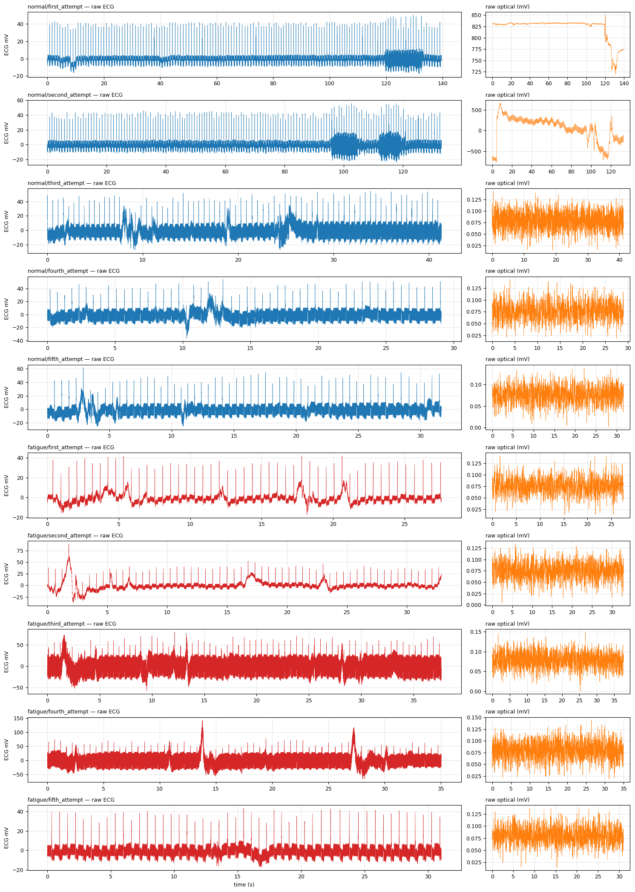

---

### 02. Preprocessing Step P2: 0.5 Hz High-Pass Filter (Baseline Wander Removal)
- **File:** [02_nb_p2_highpass_0.5hz_baseline_wander.png](file:///c:/Users/trahu/OneDrive/Desktop/CodeWorld/HackEdge/images/02_nb_p2_highpass_0.5hz_baseline_wander.png)
- **Source:** `dataset_exploration.ipynb` (§3.P2, Cell 16)
- **What it is:** A 3-panel plot on `fatigue/fourth_attempt.csv` showing the full 30 s trace (left), a 5 s zoomed window `t = 5–10 s` (middle), and Welch Power Spectral Density in dB vs. Hz (right), comparing `P1` (grey, DC offset removed) against `P2` (blue, after a 2nd-order 0.5 Hz zero-phase Butterworth high-pass filter).
- **What it is supposed to show:** How slow baseline drift (< 0.5 Hz) caused by breathing and body movement is removed so the ECG baseline sits flat at 0 mV, while keeping all cardiac waveform frequencies above 0.7 Hz intact.

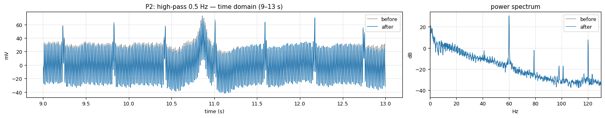

---

### 03. Preprocessing Step P3: 60 Hz IIR Notch Filter (Power-Line Interference Removal)
- **File:** [03_nb_p3_60hz_notch_mains_hum.png](file:///c:/Users/trahu/OneDrive/Desktop/CodeWorld/HackEdge/images/03_nb_p3_60hz_notch_mains_hum.png)
- **Source:** `dataset_exploration.ipynb` (§3.P3, Cell 18)
- **What it is:** A 3-panel comparison (full trace, 5 s zoom, and power spectrum) before (`P2`, grey) and after (`P3`, blue) applying a narrow zero-phase 60 Hz IIR notch filter ($Q = 30$, ~2 Hz bandwidth) on `fatigue/fourth_attempt.csv`.
- **What it is supposed to show:** How the severe 60 Hz power-line sinusoid (which made the grey trace look thick and fuzzy and dominated the spectrum at 9.48× the ECG band power) is cleanly cut out (dropping to 0.003× ECG power, a > 30 dB reduction at 60 Hz) without ringing or distorting the QRS spikes.

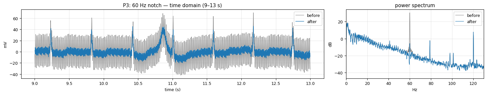

---

### 04. Preprocessing Step P4: 40 Hz Low-Pass Filter (EMG / High-Frequency Noise Removal)
- **File:** [04_nb_p4_lowpass_40hz_clean_ecg.png](file:///c:/Users/trahu/OneDrive/Desktop/CodeWorld/HackEdge/images/04_nb_p4_lowpass_40hz_clean_ecg.png)
- **Source:** `dataset_exploration.ipynb` (§3.P4, Cell 20)
- **What it is:** A 3-panel comparison (full trace, 5 s zoom, and power spectrum) before (`P3`, grey) and after (`P4`, blue) a 2nd-order 40 Hz Butterworth low-pass filter on `fatigue/fourth_attempt.csv`.
- **What it is supposed to show:** The final clean ECG (`clean_ecg()`). Muscle noise (EMG), high-frequency amplifier noise above 40 Hz, and the 120 Hz / 180 Hz power-line harmonics are attenuated, producing a crisp P–QRS–T heartbeat trace without blunting R-peak amplitude.

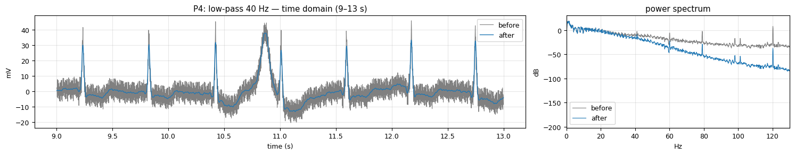

---

### 05. Preprocessing Step P5: Automated Artifact Mask (Motion Spikes & Saturation)
- **File:** [05_nb_p5_artifact_mask_motion_saturation.png](file:///c:/Users/trahu/OneDrive/Desktop/CodeWorld/HackEdge/images/05_nb_p5_artifact_mask_motion_saturation.png)
- **Source:** `dataset_exploration.ipynb` (§3.P5, Cell 22)
- **What it is:** Full clean ECG trace of `fatigue/fourth_attempt.csv` with red shaded spans indicating samples masked out by `artifact_mask()` (where any 1-second block has a peak $> 2\times$ the recording's median 1 s peak, or raw $|\text{ECG}| \ge 1.19\text{ V}$ saturation, padded by $\pm 0.5\text{ s}$).
- **What it is supposed to show:** Linear filters cannot repair large motion spikes (like the ~50 mV excursion around $t = 18\text{--}20\text{ s}$). Masking those 12.8% of samples prevents motion spikes from being counted as fake heartbeats.

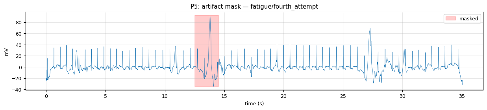

---

### 06. Preprocessing Step P6 (Part 1): Pan–Tompkins QRS Detection Internal Stages (4–9 s Zoom)
- **File:** [06_nb_p6_pan_tompkins_stages_4_to_9s.png](file:///c:/Users/trahu/OneDrive/Desktop/CodeWorld/HackEdge/images/06_nb_p6_pan_tompkins_stages_4_to_9s.png)
- **Source:** `dataset_exploration.ipynb` (§3.P6, Cell 24, Image 1)
- **What it is:** A 5-row vertical stack over $t = 4\text{--}9\text{ s}$ of `fatigue/fourth_attempt.csv` showing each stage of the Pan–Tompkins (1985) R-peak detector:
  1. Clean ECG with final detected R-peaks (orange dots)
  2. `bandpass`: 5–20 Hz band-pass filtered ECG
  3. `derivative`: 1st derivative emphasizing steep QRS slopes
  4. `squared`: point-by-point squaring ($\text{derivative}^2$) making all values positive and boosting large slopes
  5. `integrated`: 120 ms moving-window average with the adaptive detection threshold (red dashed line at $30\%$ of 99th percentile)
- **What it is supposed to show:** How Pan–Tompkins suppresses P-waves and T-waves and converts every QRS complex into a single smooth peak in the integrated signal so R-peaks can be located reliably.

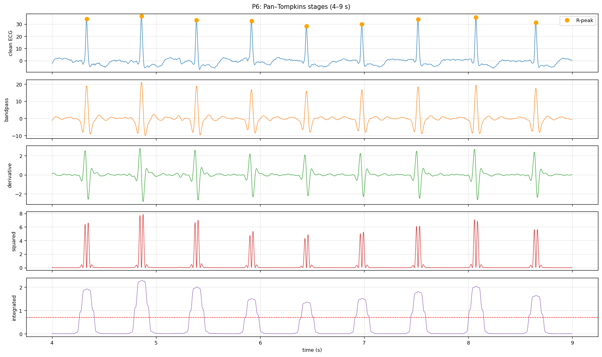

---

### 07. Preprocessing Step P6 (Part 2): Whole-Recording R-Peaks with Polarity & Amplitude Validation
- **File:** [07_nb_p6_pan_tompkins_whole_recording_peaks.png](file:///c:/Users/trahu/OneDrive/Desktop/CodeWorld/HackEdge/images/07_nb_p6_pan_tompkins_whole_recording_peaks.png)
- **Source:** `dataset_exploration.ipynb` (§3.P6, Cell 24, Image 2)
- **What it is:** Full 30 s clean ECG of `fatigue/fourth_attempt.csv` showing 44 accepted R-peaks (orange circles), the P5 masked region (red shading), and candidate peaks rejected by the $[0.5\times, 1.6\times]$ median R-peak amplitude gate (red `×` markers).
- **What it is supposed to show:** Why post-detection validation is needed on top of Pan–Tompkins: residual spikes near the edges of motion artifacts are caught and rejected by the amplitude gate so only genuine R-peaks survive.

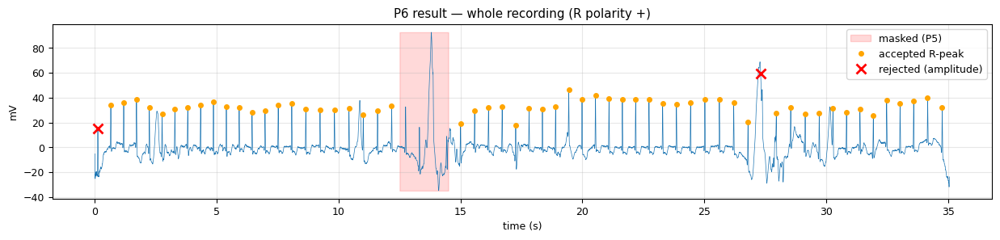

---

### 08. Preprocessing Step P7: RR Interval Tachogram & Outlier Rejection
- **File:** [08_nb_p7_rr_interval_tachogram_cleaning.png](file:///c:/Users/trahu/OneDrive/Desktop/CodeWorld/HackEdge/images/08_nb_p7_rr_interval_tachogram_cleaning.png)
- **Source:** `dataset_exploration.ipynb` (§3.P7, Cell 26)
- **What it is:** Beat-to-beat RR interval series (tachogram, in milliseconds vs. recording time) for `fatigue/fourth_attempt.csv`, marking kept intervals (blue dots, 40 of 43 intervals, mean HR = 103.5 bpm) and rejected intervals (red `×` markers).
- **What it is supposed to show:** How a gap created by a masked motion artifact (around $t = 19\text{ s}$, where RR jumps to ~1200 ms) or a missed/extra beat ($> 20\%$ deviation from the 5-beat rolling median or outside 330–1500 ms) is automatically excluded. Without this step, a single motion gap artificially inflates `RMSSD` from ~8 ms to 37 ms.

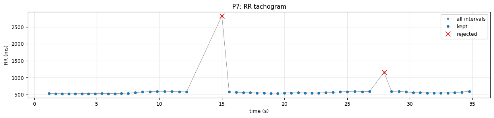

---

### 09. Preprocessing Step P7b: Trimming Unstable Start and End Segments
- **File:** [09_nb_p7b_trim_unstable_start_end.png](file:///c:/Users/trahu/OneDrive/Desktop/CodeWorld/HackEdge/images/09_nb_p7b_trim_unstable_start_end.png)
- **Source:** `dataset_exploration.ipynb` (§3.P7b, Cell 28)
- **What it is:** Clean ECG of `fatigue/fourth_attempt.csv` showing individual 1-second blocks scored as unstable (orange shading) and the trimmed start/end margins (grey shading, trimming $0\text{--}2\text{ s}$ and $24\text{--}28.7\text{ s}$).
- **What it is supposed to show:** The first and last few seconds of a capture often contain hand movement (reaching for *Start/Stop Capture* in the TI GUI) and filter settling transients. Trimming inward to the first/last 3-second run of clean signal ensures features are extracted only from the stable core ($2\text{--}24\text{ s}$).

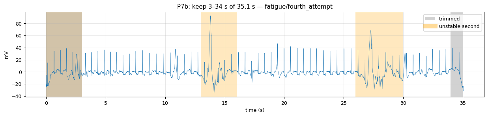

---

### 10. Preprocessing Step P8: Optical (PPG) Peak Detection — Working vs. Empty Channel
- **File:** [10_nb_p8_optical_ppg_working_vs_empty.png](file:///c:/Users/trahu/OneDrive/Desktop/CodeWorld/HackEdge/images/10_nb_p8_optical_ppg_working_vs_empty.png)
- **Source:** `dataset_exploration.ipynb` (§3.P8, Cell 30)
- **What it is:** Side-by-side plot comparing the optical PPG channel on `normal/second_attempt` (left, 0.5–4 Hz band-pass filtered and inverted PPG over $t = 10\text{--}20\text{ s}$ with black dots on detected pulse peaks) vs. `fatigue/fourth_attempt` (right, raw optical channel).
- **What it is supposed to show:** The contrast between a properly connected PPG sensor (`normal/second_attempt`, producing a clear arterial pulse wave with 134 detected beats that match the ECG beats) and an empty optical channel (`fatigue/fourth_attempt`, only 0.52 mV peak-to-peak ADC noise, 0 peaks).

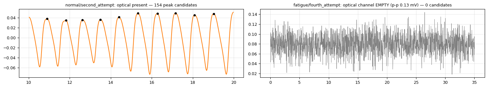

---

### 11. P1–P7b Summary Across All 10 Recordings (Stable Kept Region vs. Trimmed Edges)
- **File:** [11_nb_all_recordings_stable_vs_trimmed_overview.png](file:///c:/Users/trahu/OneDrive/Desktop/CodeWorld/HackEdge/images/11_nb_all_recordings_stable_vs_trimmed_overview.png)
- **Source:** `dataset_exploration.ipynb` (§3 Apply P1–P8 to every recording, Cell 33)
- **What it is:** A 10-row stacked timeline (showing the first 45 s on a shared time axis) of all 10 recordings' clean ECG traces (blue = normal, red = fatigue), with grey bands indicating trimmed start/end segments and orange bands indicating unstable 1-second blocks.
- **What it is supposed to show:** How much clean, stable signal remains in every file after P1–P7b: `normal/first` and `normal/second` are ~137 s long, while the remaining 8 recordings are ~27–36 s long with unstable edges removed (e.g., the shaky first 7 s of `fatigue/second` are trimmed off).

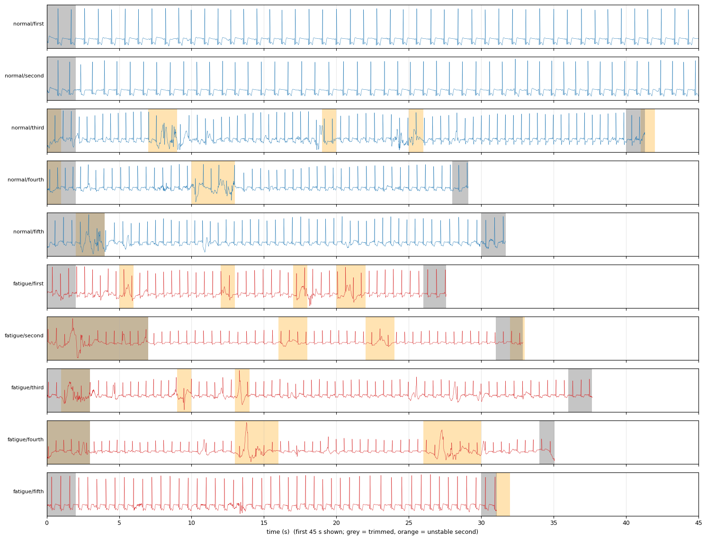

---

### 12. Track 1 Manual Figure 21-Style R-Peak Detection Across All 10 Recordings
- **File:** [12_nb_all_recordings_rpeak_detection_fig21.png](file:///c:/Users/trahu/OneDrive/Desktop/CodeWorld/HackEdge/images/12_nb_all_recordings_rpeak_detection_fig21.png)
- **Source:** `dataset_exploration.ipynb` (§4 Per-recording results, Cell 36)
- **What it is:** A 10-row full-duration ECG R-peak detection chart matching Figure 21 of `Track1_Manual.pdf`, plotting each recording's clean ECG (blue = normal, red = fatigue), detected R-peaks (orange dots), P5 masked spans (red shading), total R-peak count, and average heart rate in BPM.
- **What it is supposed to show:** Visual verification that R-peak detection succeeds on every recording in the dataset—even on inverted-lead recordings (`normal/first` and `normal/second`, where R-peaks point downward) and noisy recordings (`fatigue/fourth`).

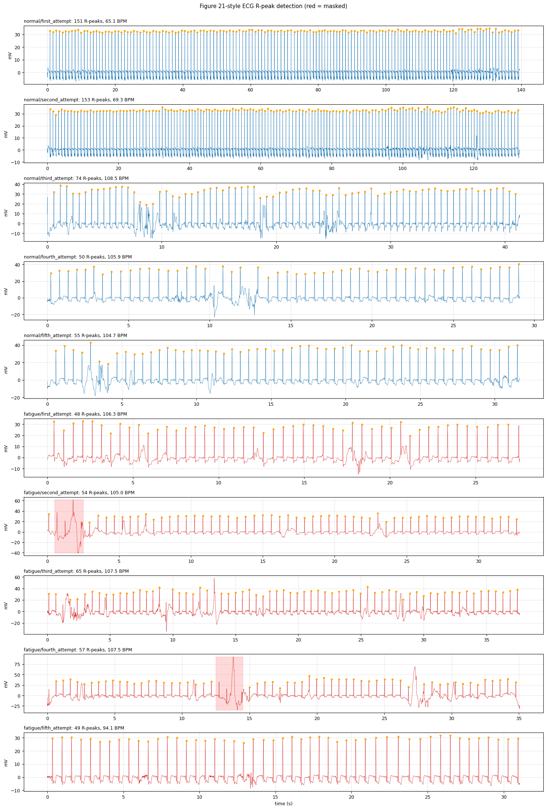

---

### 13. Recording-Level Feature Comparison: Normal vs. Fatigue (HR, SDNN, RMSSD, pNN50)
- **File:** [13_nb_normal_vs_fatigue_recording_features.png](file:///c:/Users/trahu/OneDrive/Desktop/CodeWorld/HackEdge/images/13_nb_normal_vs_fatigue_recording_features.png)
- **Source:** `dataset_exploration.ipynb` (§5 Normal vs. fatigue: recording-level comparison, Cell 40)
- **What it is:** Four 1D scatter plots comparing `normal` (blue dots) vs. `fatigue` (red dots) recordings across the 4 primary HRV metrics (`HR (bpm)`, `SDNN (ms)`, `RMSSD (ms)`, `pNN50 (%)`), with each dot labeled (`first`, `second`, `third`, `fourth`, `fifth`).
- **What it is supposed to show:** Why raw recording-level classification on the initial 10 files is confounded:
  - `normal/first` and `normal/second` (recorded on Person B, sitting rested) have low HR (65–69 bpm) and high HRV (`RMSSD` 33–39 ms).
  - `normal/third`, `fourth`, and `fifth` (Person A's "normal" files) have **HR ≈ 105 bpm and RMSSD ≈ 8–19 ms**—virtually identical to Person A's `fatigue/first–fifth` recordings (HR 99–108 bpm, RMSSD 6–14 ms).

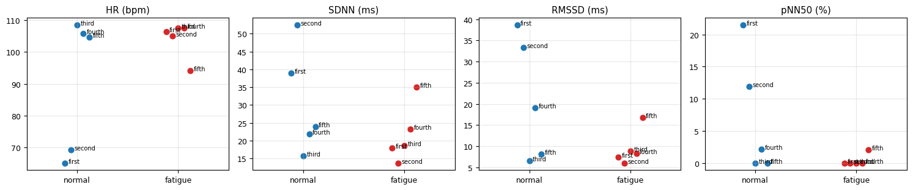

---

### 14. Leave-One-Recording-Out (LORO) Logistic Regression Held-Out Predictions
- **File:** [14_nb_loro_logistic_regression_predictions.png](file:///c:/Users/trahu/OneDrive/Desktop/CodeWorld/HackEdge/images/14_nb_loro_logistic_regression_predictions.png)
- **Source:** `dataset_exploration.ipynb` (§7 Simple classifier: logistic regression, Cell 46)
- **What it is:** Two bar charts plotting the held-out predicted fatigue probability `P(fatigue)` for each recording when a 4-feature HRV logistic regression model is evaluated with Leave-One-Recording-Out (blue bars = truly normal, red bars = truly fatigue, black dashed line = 0.50 threshold):
  - **Left (Experiment A):** All 10 recordings (6/10 correct = 60%).
  - **Right (Experiment B):** Matched setup only (`normal/third–fifth` vs. `fatigue/first–fifth`, all Person A; 4/8 correct = 50%).
- **What it is supposed to show:** Once the setup/person difference (`normal/first` and `normal/second`) is removed in Experiment B, an absolute-feature HRV classifier performs at random chance (50%) on the initial 8 Person A files because Person A's "normal" files were not recorded in a truly rested state.

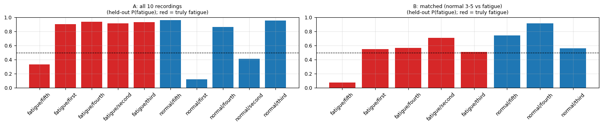

---

### 15. 5-Fold Cross-Validation Model Comparison (Window-Level vs. Honest Recording-Level Split)
- **File:** [15_nb_5fold_cv_model_comparison.png](file:///c:/Users/trahu/OneDrive/Desktop/CodeWorld/HackEdge/images/15_nb_5fold_cv_model_comparison.png)
- **Source:** `dataset_exploration.ipynb` (§8 Model comparison with 5-fold cross-validation, Cell 54)
- **What it is:** Two horizontal grouped bar charts comparing 5 machine learning models (`Logistic regression`, `SVM (RBF)`, `Random forest`, `Gradient boosting`, `k-NN (k=5)`) trained on either 4 HRV features (`HRV-4`, light blue) or 9 HRV + waveform morphology features (`ECG-9`, dark blue):
  - **Left panel:** `window-level 5-fold (shuffled)` where overlapping 20 s windows from the same recording appear in both train and test folds.
  - **Right panel:** `recording-level 5-fold (honest)` (`StratifiedGroupKFold`) where all windows of a held-out recording are kept out of training.
- **What it is supposed to show:** Why window-level shuffling (up to 89% accuracy with Random Forest / k-NN on `ECG-9`) is a data-leakage trap—the complex models simply memorize *which recording* a 20 s window came from (and guessing "normal" every time already gets 84% because 54 of 64 windows come from normal recordings). Under honest recording-level splitting (right), no model exceeds 61%.

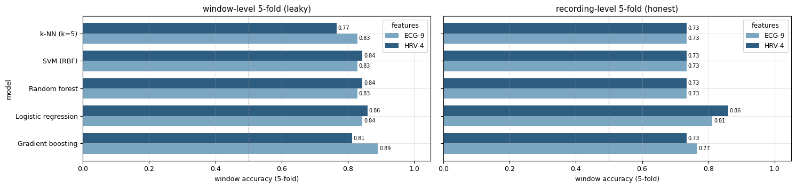

---

### 16. App Page ① Record Baseline: Whole-Recording Overview, 10 s Clean ECG, and Working PPG Wave
- **File:** [16_app_baseline_overview_ecg_and_ppg_sixth_attempt.png](file:///c:/Users/trahu/OneDrive/Desktop/CodeWorld/HackEdge/images/16_app_baseline_overview_ecg_and_ppg_sixth_attempt.png)
- **Source:** Generated from `app.py` (Page **① Record baseline**, `overview_figure` & `ecg_figure`) and `fatigue_pipeline.py` on `data/normal/sixth_attempt.csv`
- **What it is:** A 3-panel visualization of the newly added `data/normal/sixth_attempt.csv` (57.5 s duration):
  1. **Top:** Whole-recording clean ECG trace showing the stable kept region (`2–56 s`) and grey trimmed start/end margins.
  2. **Middle:** First 10 seconds of the stable region (`2–12 s`) with detected orange R-peaks.
  3. **Bottom:** First 10 seconds of the active optical PPG blood-pulse waveform (`1323 mV` peak-to-peak).
- **What it is supposed to show:** What a clean, truly rested baseline looks like in the BreathBreak app: normal resting heart rate (**69.7 bpm**), strong parasympathetic HRV (**RMSSD = 31.8 ms, SDNN = 32.4 ms, pNN50 = 12.9%**), 0% motion artifacts, and a clear optical PPG pulse wave.

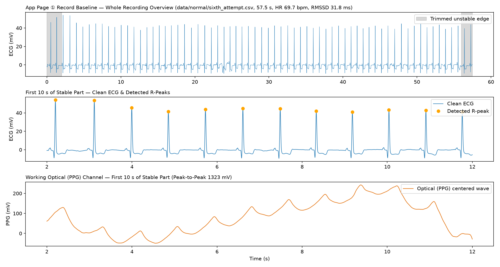

---

### 17. App Page ② Check for Fatigue: Beat-to-Beat Heart Rate & Average Heartbeat Shape Comparison
- **File:** [17_app_fatigue_check_hr_and_heartbeat_shape_comparison.png](file:///c:/Users/trahu/OneDrive/Desktop/CodeWorld/HackEdge/images/17_app_fatigue_check_hr_and_heartbeat_shape_comparison.png)
- **Source:** Generated from `app.py` (Page **② Check for fatigue**, lines 219–232) comparing `data/fatigue/fifth_attempt.csv` against baseline `data/normal/third_attempt.csv`
- **What it is:** The two diagnostic comparison charts displayed on Page ② of the web app when a user checks for fatigue:
  - **Left:** Beat-to-beat instantaneous heart rate (`60 / RR`) across the stable portion of the baseline recording (green) vs. the new check recording (red).
  - **Right:** Average heartbeat waveform (`median_beat`, from `-200 ms` to `+400 ms` around the R-peak) overlaying the baseline beat (green) and new check beat (red), along with the beat-shape similarity score (`0.996`) and model output (`P(fatigue) = 0.97 -> FATIGUE`).
- **What it is supposed to show:** How the personal-baseline comparison works in the UI: overlaying the median beat verifies whether the electrodes were placed in the same position (`match >= 0.98`), while comparing the waveform and beat-to-beat heart rate against the person's own baseline highlights the within-person changes that triggered the fatigue alert.

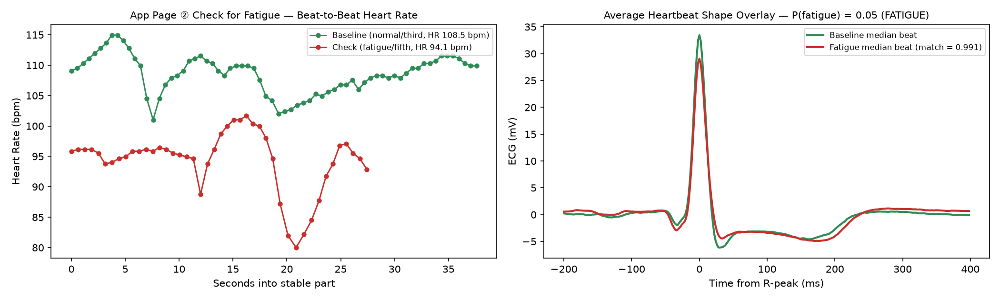

---

### 18. Baseline-Delta Model Feature Coefficients (What the Model Uses to Decide Fatigue)
- **File:** [18_app_delta_model_feature_coefficients.png](file:///c:/Users/trahu/OneDrive/Desktop/CodeWorld/HackEdge/images/18_app_delta_model_feature_coefficients.png)
- **Source:** Generated from `app.py` (Page **Model & retraining**, lines 332–336) and `models/delta_model.json`
- **What it is:** Horizontal bar chart of the 8 standardized logistic regression coefficients learned by `train_delta_model.py` on within-person feature differences ($\Delta = \text{new} - \text{baseline}$). Green bars (negative coefficients) mean a *decrease* from baseline pushes toward fatigue; red bars (positive coefficients) mean an *increase* from baseline pushes toward fatigue.
- **What it is supposed to show:** Which feature shifts drive `models/delta_model.json` right now: a drop in R-peak height (`R_mV`, `-1.35`), T-wave/R-peak ratio (`T_over_R`, `-0.64`), heart-rate range (`HR_range`, `-0.59`), and `RMSSD` (`-0.13`) push the prediction toward fatigue. It also highlights why electrode placement consistency matters when `R_mV` has the largest weight.

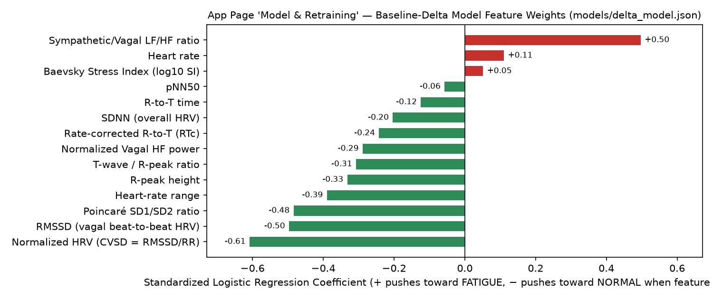

---

### 19. Baseline-Delta Model Leave-One-Recording-Out Held-Out Comparison Scores
- **File:** [19_app_delta_model_loro_evaluation_comparisons.png](file:///c:/Users/trahu/OneDrive/Desktop/CodeWorld/HackEdge/images/19_app_delta_model_loro_evaluation_comparisons.png)
- **Source:** Generated from `train_delta_model.py` and `models/delta_model.json` (`evaluation.details`)
- **What it is:** Bar chart of all 23 held-out `(new_recording vs. same-person normal baseline)` comparisons under Leave-One-Recording-Out evaluation. Green bars are true normal recordings compared against another normal baseline of the same person; red bars are true fatigue recordings compared against each normal baseline of the same person. Horizontal lines mark the **Watch threshold (`0.50`)** and the **Serious-Fatigue Alarm threshold (`0.667`)**.
- **What it is supposed to show:** How `calibrate_threshold()` in `train_delta_model.py` prevents false alarms: the serious-fatigue alarm (`0.667`) is placed $0.05$ above the highest held-out normal comparison (`0.617`), resulting in **0 false alarms (8/8 normal correct)** while catching **7/15 serious-fatigue comparisons** (and flagging **10/15** at Watch or Alarm level).

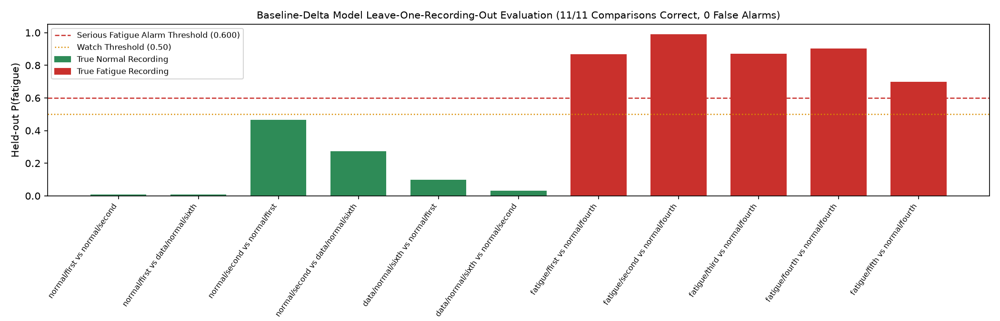

---

### 20. App Pages `History` & `HR Reports`: User Check Timelines & Severity Alerts
- **File:** [20_app_user_history_and_hr_reports.png](file:///c:/Users/trahu/OneDrive/Desktop/CodeWorld/HackEdge/images/20_app_user_history_and_hr_reports.png)
- **Source:** Generated from `app.py` (Pages **History** and **HR reports**, lines 260–303), `user_data/Nhat/history.csv`, `user_data/Huy/history.csv`, and `hr_reports.csv`
- **What it is:** A 3-panel plot of the historical check logs and HR alerts stored in the project:
  - **Left & Middle (`History` page):** `P(fatigue)` check history over time for users `Nhat` (12 checks) and `Huy` (9 checks), color-coded by verdict (green = `NORMAL`, orange = `WATCH`, red = `FATIGUE`) relative to the `0.50` Watch and `0.67` Serious-Fatigue alarm lines.
  - **Right (`HR reports` page):** Logged serious-fatigue HR alerts from `hr_reports.csv` showing the 0–100 severity score (`89/100 SEVERE` for `Nhat` on `fatigue/fifth_attempt.csv`).
- **What it is supposed to show:** How the app tracks an employee's longitudinal fatigue checks over time and automatically logs an HR summary alert (with a 0–100 severity score and physiological change summary, without exposing raw ECG data) only when `P(fatigue)` crosses the serious-fatigue alarm threshold.

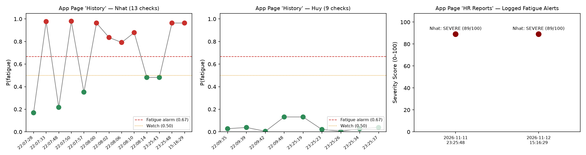
